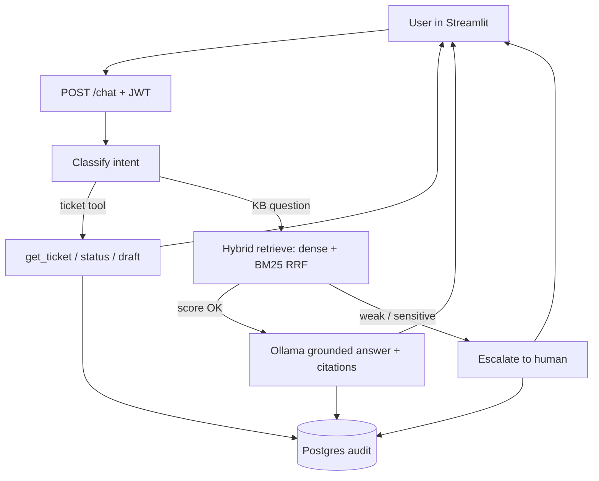

 # ResolveAI

Production-oriented **AI customer support agent**: grounded RAG answers with citations, ticket tools, and human escalation when confidence is low or the request is sensitive.

| Layer | Choice |
|-------|--------|
| UI | Streamlit (customer + admin) |
| API | FastAPI + JWT RBAC |
| Agent | LangGraph (classify → tools \| RAG \| escalate) |
| LLM / Embed | Ollama `qwen2.5:3b` + `nomic-embed-text` |
| Data | PostgreSQL + Qdrant (hybrid dense + BM25 RRF) |

**Status:** M0–M8 + M10–M12 done. M9 (rerank) skipped. Detail docs: [architecture](docs/architecture.md) · [API](docs/api.md) · [deploy](docs/deploy.md)

---

## Architecture

```text
┌─────────────┐     JWT      ┌──────────────────────────────────────┐
│  Streamlit  │─────────────▶│  FastAPI                             │
│  UI :8501   │              │  rate limit · request ID · headers   │
└─────────────┘              └──────────────┬───────────────────────┘
                                            │
                                   LangGraph agent
                            classify → route_intent
                           /            |            \
                      tools        retrieve_answer    escalate
                   (tickets)      (hybrid RAG)      (human handoff)
                           \            |            /
                            └───────────┴────────────┘
                                  │           │
                         ┌────────▼──┐   ┌────▼─────┐
                         │ PostgreSQL│   │  Qdrant  │
                         │ users,    │   │  chunks  │
                         │ tickets,  │   └────┬─────┘
                         │ audit     │        │
                         └───────────┘   ┌────▼─────┐
                                         │  Ollama  │
                                         │ embed+chat│
                                         └──────────┘
```

### Request flow (chat)



### Knowledge ingest

```text
Admin upload → parse (PDF/DOCX/TXT/FAQ) → chunk → embed (Ollama)
                                              ├─▶ Qdrant vectors
                                              └─▶ Postgres knowledge_documents
```

---

## Run end-to-end (Docker — recommended demo)

**Need:** Docker Desktop, ~4 GB free RAM, internet once (images + models).

### 1. Configure

```bash
cp .env.example .env
```

Local defaults are fine for demo. Change secrets before any shared/public host.

### 2. Start the stack

```bash
docker compose -f docker/docker-compose.yml up -d --build
```

Starts: Postgres, Qdrant, Ollama, API (Alembic migrate on boot), Streamlit UI.

### 3. Pull models (first time only)

```bash
docker compose -f docker/docker-compose.yml exec ollama ollama pull qwen2.5:3b
docker compose -f docker/docker-compose.yml exec ollama ollama pull nomic-embed-text
```

### 4. Seed users + NovaDesk KB

```bash
docker compose -f docker/docker-compose.yml exec api resolveai-seed
docker compose -f docker/docker-compose.yml exec api resolveai-seed-kb
```

### 5. Open the demo

| What | URL |
|------|-----|
| UI | http://localhost:8501 |
| API docs | http://localhost:8000/docs |
| Ready probe | http://localhost:8000/ready |

| Role | Email | Password |
|------|-------|----------|
| Customer | `customer@resolveai.local` | `customer123!` |
| Admin | `admin@resolveai.local` | `admin123!` |

**Try:** chat “How do I reset my password?” · open Tickets · admin KB / escalations.

### 6. Stop

```bash
docker compose -f docker/docker-compose.yml down
```

---

## Run without full Compose (API + deps)

```powershell
pip install -e ".[dev]"
$env:PYTHONPATH = "packages/common/src;packages/db/src;packages/rag/src;packages/agent/src;apps/api/src"
docker compose -f docker/docker-compose.yml up -d postgres qdrant ollama
# pull models into ollama as above
alembic -c packages/db/alembic.ini upgrade head
resolveai-seed
resolveai-seed-kb
uvicorn resolveai_api.main:app --reload --host 127.0.0.1 --port 8000
```

UI in another shell:

```powershell
$env:API_BASE_URL = "http://127.0.0.1:8000"
streamlit run apps/ui/app.py
```

---

## Tests & eval

```powershell
pytest tests -q

$env:PYTHONPATH = ".;packages/common/src;packages/db/src;packages/rag/src;packages/agent/src;apps/api/src"
python -m eval.runners.baseline --compare
```

### Offline dense vs hybrid (measured)

| Metric | Dense | Hybrid | Delta |
|--------|------:|-------:|------:|
| Status accuracy | 0.70 | 0.70 | 0.00 |
| Keyword accuracy | 0.27 | **0.40** | **+0.13** |
| Escalation accuracy | 0.85 | 0.85 | 0.00 |
| Citation validity | 1.00 | 1.00 | 0.00 |

Default: `RETRIEVAL_MODE=hybrid`. Reports under `eval/reports/`.

---

## Repo layout

```text
apps/api          FastAPI
apps/ui           Streamlit
packages/agent    LangGraph
packages/rag      ingest, hybrid retrieve, answer
packages/db       SQLAlchemy + Alembic
packages/common   settings, retry, redact
eval/             golden set + baseline runner
docker/           Compose stack
docs/             architecture, API, deploy
```

---

## Limitations

- Local demo stack — not multi-tenant SaaS; in-memory rate limit per API process.
- Offline eval uses HashEmbedder + FakeLLM (mode comparison, not live-model claims). Use `--live` with Ollama for real answers.
- Small chat model + keyword/score escalation — not perfect policy.
- M9 rerank not shipped.

---

## License

Proprietary / project demo — adjust as needed.
