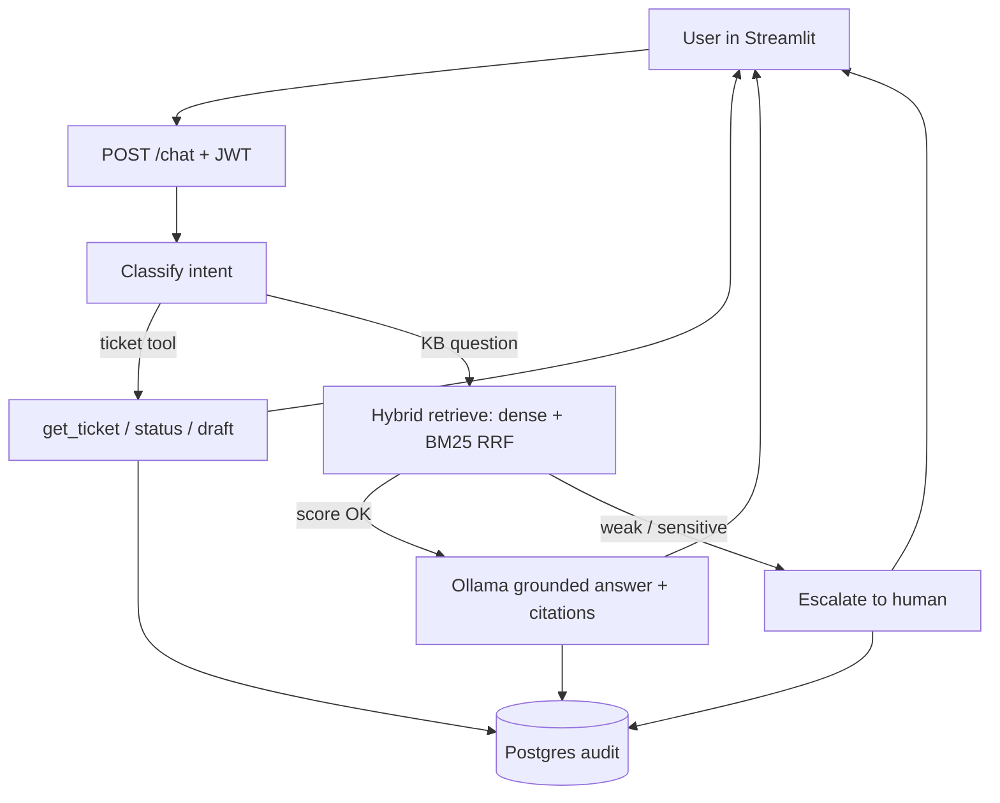
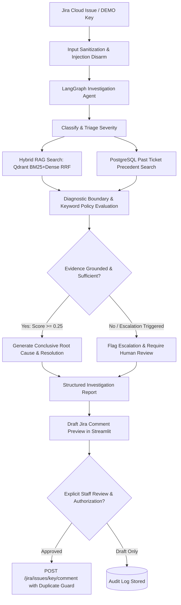

# ResolveAI


Production-oriented **AI customer support agent**: grounded RAG answers with citations, ticket tools, and human escalation when confidence is low or the request is sensitive.

| Layer | Choice |
|-------|--------|
| UI | Streamlit Enterprise Design System (Dark Navy Sidebar + Crisp Workspace) |
| API | FastAPI + JWT RBAC (`/analytics`, `/tickets`, `/kb`, `/chat`, `/feedback`, `/jira`) |
| Agent | LangGraph (classify → tools | RAG | escalate + AI investigation workflow) |
| LLM / Embed | Ollama `qwen2.5:3b` + `nomic-embed-text` |
| Data | PostgreSQL + Qdrant (hybrid dense + BM25 RRF) |
| Integrations | Jira Cloud REST API (Issue investigation & comment publishing) |

**Status:** Jira Integration & AI Investigation Layer complete. Detail docs: [architecture](docs/architecture.md) · [API](docs/api.md) · [deploy](docs/deploy.md)

---

## Architecture

```text
┌─────────────┐     JWT      ┌──────────────────────────────────────┐
│  Streamlit  │─────────────▶│  FastAPI                             │
│  UI :8501   │              │  rate limit · request ID · headers   │
└─────────────┘              └──────────────┬───────────────────────┘
                                            │
                                   LangGraph agent
                            classify → route_intent
                           /            |            \
                      tools        retrieve_answer    escalate
                   (tickets)      (hybrid RAG)      (human handoff)
                           \            |            /
                            └───────────┴────────────┘
                                  │           │
                         ┌────────▼──┐   ┌────▼─────┐
                         │ PostgreSQL│   │  Qdrant  │
                         │ users,    │   │  chunks  │
                         │ tickets,  │   └────┬─────┘
                         │ audit     │        │
                         └───────────┘   ┌────▼─────┐
                                         │  Ollama  │
                                         │ embed+chat│
                                         └──────────┘
```

### Request flow (chat)



### Knowledge ingest

```text
Admin upload → parse (PDF/DOCX/TXT/FAQ) → chunk → embed (Ollama)
                                              ├─▶ Qdrant vectors
                                              └─▶ Postgres knowledge_documents
```

### Jira AI Investigation & Resolution Layer

ResolveAI connects directly with Jira Cloud issues to investigate customer defects, verify technical hypotheses against grounded documentation, and safely generate resolution comments.



---

## Jira Cloud Configuration (Optional)

To connect live Jira Cloud to ResolveAI:

1. In Jira, generate an API token at: [https://id.atlassian.com/manage-profile/security/api-tokens](https://id.atlassian.com/manage-profile/security/api-tokens)
2. Add the following to your `.env` file (or environment):
   ```bash
   JIRA_BASE_URL=https://your-domain.atlassian.net
   JIRA_EMAIL=engineer@company.com
   JIRA_API_TOKEN=your-jira-api-token
   JIRA_PROJECT_KEY=SUP
   ```
3. If Jira credentials are not provided, ResolveAI automatically activates **Sandbox Demo Mode** allowing full local evaluation using demo issues `DEMO-101` (Conclusive grounded password inquiry) and `DEMO-102` (Escalation safety policy trigger).

---

## Run end-to-end (Docker — recommended demo)

**Need:** Docker Desktop, ~4 GB free RAM, internet once (images + models).

### 1. Configure

```bash
cp .env.example .env
```

Local defaults are fine for demo. Change secrets before any shared/public host.

### 2. Start the stack

```bash
docker compose -f docker/docker-compose.yml up -d --build
```

Starts: Postgres, Qdrant, Ollama, API (Alembic migrate on boot), Streamlit UI.

### 3. Pull models (first time only)

```bash
docker compose -f docker/docker-compose.yml exec ollama ollama pull qwen2.5:3b
docker compose -f docker/docker-compose.yml exec ollama ollama pull nomic-embed-text
```

### 4. Seed users + NovaDesk KB

```bash
docker compose -f docker/docker-compose.yml exec api resolveai-seed
docker compose -f docker/docker-compose.yml exec api resolveai-seed-kb
```

### 5. Open the demo

| What | URL |
|------|-----|
| UI | http://localhost:8501 |
| API docs | http://localhost:8000/docs |
| Ready probe | http://localhost:8000/ready |

| Role | Email | Password | Allowed Workspace Pages |
|------|-------|----------|--------------------------|
| Customer | `customer@resolveai.local` | `customer123!` | **Support:** Overview · Tickets · AI Assistant |
| Admin | `admin@resolveai.local` | `admin123!` | **Support:** Overview · Tickets · AI Assistant · Human Review · Jira Investigation<br>**Admin:** Knowledge Base · AI Evaluation · Settings & Health |

**Key Demonstration Features:**
- **Jira AI Investigation Layer:** Real-time lookup of Jira Cloud issues, LangGraph diagnostic workflow, grounded root-cause hypotheses, historical precedent cross-referencing, draft report generation, and explicit human approval before comment publishing (with duplicate comment prevention).
- **Overview Dashboard:** Live telemetry, ticket status & priority distribution, real AI automation rate, recent escalation feed.
- **Searchable Ticket Workspace:** Search by subject/category/ID, status & priority filters, full conversation timeline, and staff triage metadata editing (`PATCH /tickets/{id}`).
- **AI Assistant:** Suggested questions, verified citations with document titles & relevance scores, policy escalation notices, helpful/not-helpful feedback, and collapsible developer diagnostics.
- **Human Review & Escalation Queue:** Review sensitive or low-confidence tickets, edit draft replies, and explicitly approve & publish official responses.
- **Knowledge Base:** Upload `.pdf`, `.docx`, `.txt`, `.json`, `.faq` with duplicate prevention, indexed vs failed tabs, and interactive test retrieval chunk inspector.
- **AI Evaluation:** Measured hybrid vs dense benchmark comparison across 120 golden test cases, showing keyword accuracy lift (+13.3%), 100% citation validity, and query kind breakdown.
- **Settings & System Health:** Live dependency probes (Postgres, Qdrant, Ollama), active retrieval settings, and credential hygiene audit.

### 6. Stop

```bash
docker compose -f docker/docker-compose.yml down
```

---

## Run without full Compose (API + deps)

```powershell
pip install -e ".[dev]"
$env:PYTHONPATH = "packages/common/src;packages/db/src;packages/rag/src;packages/agent/src;apps/api/src"
docker compose -f docker/docker-compose.yml up -d postgres qdrant ollama
# pull models into ollama as above
alembic -c packages/db/alembic.ini upgrade head
resolveai-seed
resolveai-seed-kb
uvicorn resolveai_api.main:app --reload --host 127.0.0.1 --port 8000
```

UI in another shell:

```powershell
$env:API_BASE_URL = "http://127.0.0.1:8000"
streamlit run apps/ui/app.py
```

---

## Tests & eval

```powershell
pytest tests -q

$env:PYTHONPATH = ".;packages/common/src;packages/db/src;packages/rag/src;packages/agent/src;apps/api/src"
python -m eval.runners.baseline --compare
```

### Offline dense vs hybrid (measured)

| Metric | Dense | Hybrid | Delta |
|--------|------:|-------:|------:|
| Status accuracy | 0.70 | 0.70 | 0.00 |
| Keyword accuracy | 0.27 | **0.40** | **+0.13** |
| Escalation accuracy | 0.85 | 0.85 | 0.00 |
| Citation validity | 1.00 | 1.00 | 0.00 |

Default: `RETRIEVAL_MODE=hybrid`. Reports under `eval/reports/`.

---

## Repo layout

```text
apps/api          FastAPI
apps/ui           Streamlit
packages/agent    LangGraph
packages/rag      ingest, hybrid retrieve, answer
packages/db       SQLAlchemy + Alembic
packages/common   settings, retry, redact
eval/             golden set + baseline runner
docker/           Compose stack
docs/             architecture, API, deploy
```

---

## 7. Remaining Incomplete Features or Known Gaps

- **Atlassian Webhooks**: Inbound Jira webhooks (automatic triggering on issue creation in Jira) are not implemented; investigation is currently initiated on-demand by authorized staff to prevent runaway LLM costs and ensure human oversight.
- **Bi-directional Status Synchronization**: The application deliberately refrains from auto-transitioning Jira issue statuses (e.g. Open -> Resolved) to satisfy safety and least-privilege requirements; state transitions remain under staff discretion.

### General Limitations

- Local demo stack — not multi-tenant SaaS; in-memory rate limit per API process.
- Offline eval uses HashEmbedder + FakeLLM (mode comparison, not live-model claims). Use `--live` with Ollama for real answers.
- Small chat model + keyword/score escalation — not perfect policy.
- M9 rerank not shipped.

---

## License

Proprietary / project demo — adjust as needed.

