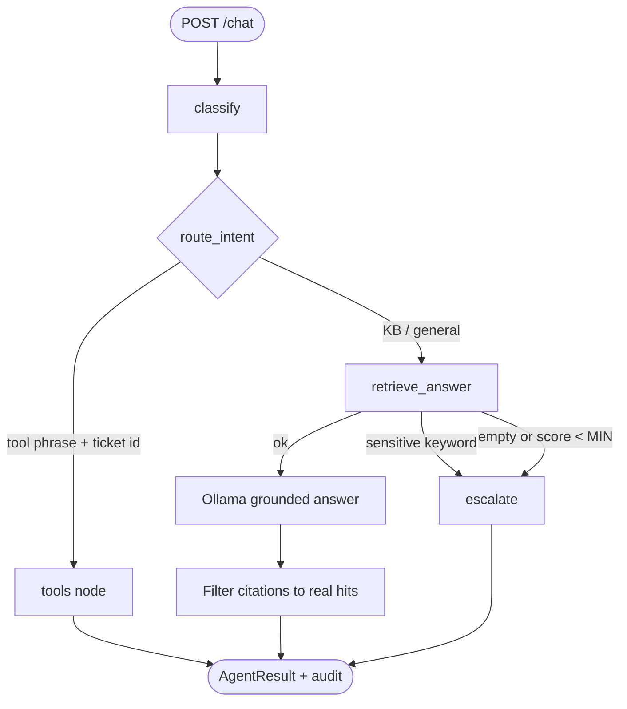

# ResolveAI Architecture

## Problem

Support teams spend time on repetitive, document-answerable questions while risky or novel cases need humans. Generic chatbots hallucinate. ResolveAI answers from a knowledge base with citations and escalates when it should not guess.

## Goals

| Goal | How |
|------|-----|
| Grounded answers | Retrieve KB chunks → constrain LLM to numbered sources → validate citations |
| Safe escalation | Sensitive keywords + low retrieval score → human handoff |
| Explicit agent | LangGraph nodes/edges (testable, auditable `trace`) |
| Demo-friendly | Local Ollama + Docker Compose; no cloud API keys required |
| Measured quality | Golden JSONL + offline/live eval runners — no fabricated metrics |

## Stack

| Layer | Choice | Why |
|-------|--------|-----|
| UI | Streamlit | Fast dual-role demo (customer / admin) |
| API | FastAPI | Typed HTTP, OpenAPI, middleware |
| Agent | LangGraph | Explicit classify → tools \| RAG graph |
| LLM | Ollama `qwen2.5:3b` | Small, local, interview-demo friendly |
| Embeddings | Ollama `nomic-embed-text` | Local RAG embeddings (768-d) |
| Relational DB | PostgreSQL | Users, tickets, messages, KB metadata, audit, feedback |
| Vectors | Qdrant | Dense search; BM25 fused in-process |
| Auth | JWT + roles | Customer vs admin RBAC |
| Eval | Pytest + golden set | Measured quality, not vibes |

## System context

```text
┌─────────────┐     JWT      ┌──────────────────────────────────────┐
│  Streamlit  │─────────────▶│  FastAPI                             │
│  UI :8501   │              │  CORS · rate limit · request ID      │
└─────────────┘              │  security headers · redacted errors  │
                             └──────────────┬───────────────────────┘
                                            │
                                   LangGraph support agent
                                            │
              ┌─────────────────────────────┼─────────────────────────────┐
              │                             │                             │
              ▼                             ▼                             ▼
        Ticket tools                 Hybrid RAG                    Escalate
     get_ticket / status            dense + BM25 RRF              keywords or
     create_draft (no send)         → Ollama answer               weak score
              │                             │                             │
              └──────────────┬──────────────┴──────────────┬──────────────┘
                             ▼                             ▼
                      ┌────────────┐                ┌────────────┐
                      │ PostgreSQL │                │   Qdrant   │
                      │ users      │                │  chunks    │
                      │ tickets    │                └─────┬──────┘
                      │ audit      │                      │
                      └────────────┘                ┌─────▼──────┐
                                                    │   Ollama   │
                                                    │ embed+chat │
                                                    └────────────┘
```

## Package layout

```text
apps/api              FastAPI routers, middleware, deps
apps/ui               Streamlit pages + thin HTTP client
packages/agent        LangGraph graph, classify, tools
packages/rag          parse, chunk, embed, hybrid store, answer
packages/db           SQLAlchemy models, Alembic, seed
packages/common       settings, logging, retry, redact
eval/                 golden_v1.jsonl + baseline runner
docker/               Compose (postgres, qdrant, ollama, api, ui)
docs/                 this file, api.md, deploy.md
```

## Auth model

- `POST /auth/register` always creates `customer` (cannot self-elevate).
- Admins come from `resolveai-seed` or controlled provisioning.
- `Authorization: Bearer <JWT>` for users.
- Customers see only their tickets; admins see all tickets + KB admin routes.
- Streamlit keeps the access token in session state only — no secrets in the browser beyond that.

## Knowledge base pipeline

```text
Admin upload (multipart)
    → parse PDF / DOCX / TXT / FAQ JSON
    → chunk (CHUNK_SIZE / CHUNK_OVERLAP)
    → embed via Ollama (retries on transient failure)
    → upsert points to Qdrant
    → row in Postgres knowledge_documents (status, chunk_count)
```

Seed path: `resolveai-seed-kb` indexes files under `data/kb/` the same way.

## Hybrid retrieval (default)

```text
query text
   ├─ embed → dense top-N (Qdrant query_points)
   └─ BM25 top-N (in-memory index over chunk texts)
            ↓
   Reciprocal Rank Fusion (HYBRID_RRF_K)
            ↓
   top-k hits (RETRIEVAL_TOP_K)
```

Set `RETRIEVAL_MODE=dense` to disable BM25 fusion. Offline compare showed **+0.13 keyword accuracy** for hybrid with flat status/latency — hybrid kept. Cross-encoder rerank (M9) deferred.

## LangGraph agent



### Nodes

| Node | Responsibility |
|------|----------------|
| `classify` | Heuristic category / priority / urgency |
| `route_intent` | Detect tool intent vs retrieve |
| `tools` | `get_ticket`, `get_ticket_status`, `create_draft_response` (draft never emails) |
| `retrieve_answer` | Keyword gate → hybrid search → answer or escalate |

`trace` on the response lists nodes visited (demo / interview artifact).

## Grounded answering

1. Build a prompt with numbered sources `[1]…[n]` from retrieval hits.
2. Ask Ollama to answer **only** from those sources and cite `[n]`.
3. Drop any citation index that does not map to a real hit.
4. Persist audit log; optionally append messages / set ticket `escalated`.

## UI roles

| Role | Pages |
|------|--------|
| Customer | Login, chat, own tickets, thumbs feedback |
| Admin | Same + KB upload/search + escalations queue + draft tool |

## Hardening

| Control | Behavior |
|---------|----------|
| Rate limit | In-memory sliding window per client IP |
| Retries | Exponential backoff on Ollama embed/chat |
| Request ID | `X-Request-ID` generated or echoed |
| Security headers | `nosniff`, `DENY` frame, `no-referrer`, `no-store` |
| Redaction | Mask bearer/password/token patterns in error logs |
| Production guard | Fail startup on weak secrets when `APP_ENV=production` |
| Errors | Generic 500 JSON; no stack traces to clients |

## Evaluation

- Dataset: `eval/datasets/golden_v1.jsonl` (120 cases)
- Runner: `python -m eval.runners.baseline` (`--compare`, `--live`)
- Offline: HashEmbedder + FakeLLM (honest mode comparison)
- Live: real Ollama when stack is up
- Reports only under `eval/reports/` (measured, never hand-waved)

## Milestone map

| Milestone | Status |
|-----------|--------|
| M0–M8 foundation through hybrid | Done |
| M9 rerank | Skipped (no measured lift yet) |
| M10 hardening | Done |
| M11 Docker/CI | Done |
| M12 docs + limitations | Done |

## Jira AI Investigation & Resolution Layer

ResolveAI connects to Jira Cloud (and sandbox mode) with a specialized LangGraph investigation agent:
- Triage & categorization from ticket summary and description.
- Input sanitization disarming prompt injection and stripping control characters.
- Grounded retrieval via Qdrant (hybrid dense + BM25 RRF) against technical documentation.
- Precedent matching against resolved historical tickets in PostgreSQL.
- Diagnostic boundary checks and safety policy evaluation.
- Structured report generation with root cause hypothesis, action plan, and draft comment.
- Explicit human review authorization before any comment is posted to Jira.

## 7. Remaining Incomplete Features or Known Gaps

- **Atlassian Webhooks**: Inbound Jira webhooks (automatic triggering on issue creation in Jira) are not implemented; investigation is currently initiated on-demand by authorized staff to prevent runaway LLM costs and ensure human oversight.
- **Bi-directional Status Synchronization**: The application deliberately refrains from auto-transitioning Jira issue statuses (e.g. Open -> Resolved) to satisfy safety and least-privilege requirements; state transitions remain under staff discretion.

### Architectural Rationale & Threat Model
1. **Cost & Loop Protection:** Automatically running LLM workflows on every inbound webhook payload exposes systems to uncontrolled LLM compute consumption, webhook replay storms, and prompt injection embedded in issue descriptions. By requiring staff initiation, cost is bounded and every investigation is intentional.
2. **Safety & Least-Privilege Guardrails:** Automatically closing or resolving customer support tickets without human sign-off can mask ongoing outages, alienate customers, and violate SOC2/audit compliance. Transitions are exposed via `GET/POST /jira/issues/{key}/transitions` but strictly require human staff execution.

## Related

- [API reference](api.md)
- [Deploy / runbook](deploy.md)
- [Root README](../README.md)

